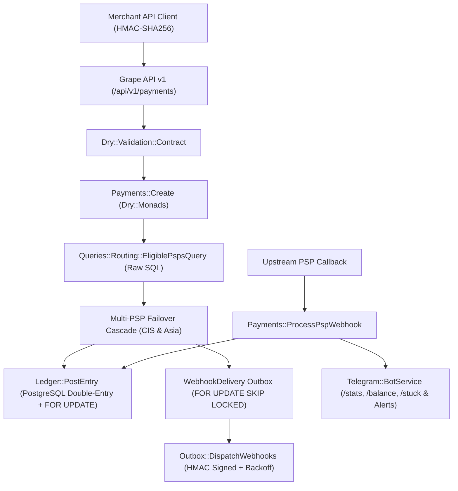

# PayGate Rails Acquiring

High-risk payment acquiring & multi-PSP cascade orchestration backend built with **Ruby 3.3, Ruby on Rails 7.2, Grape API, Dry-rb (`dry-validation`, `dry-monads`), PostgreSQL (raw SQL CTEs, `FOR UPDATE SKIP LOCKED`, double-entry ledger), and RSpec**.

Designed for CIS & Asia payment flows (`RUB`, `KZT`, `UZS`, `INR`, `THB`, `USD`, `USDT`) with merchant-level cascade customization, idempotent external APIs, transactional webhook outbox delivery, and Telegram operational bot alerts.

---

## Architecture



---

## Key Engineering Highlights

### 1. Versioned External Merchant & PSP API (`Grape` + `Grape::Entity`)
- **HMAC-SHA256 Request Authentication** (`Security::HmacSigner`) with clock-skew protection (`300s`) and constant-time comparison (`ActiveSupport::SecurityUtils.secure_compare`).
- **Strict Idempotency** enforced at both service and PostgreSQL constraint levels (`UNIQUE (merchant_id, idempotency_key)`).
- Endpoints:
  - `POST /api/v1/payments` — create payment with automatic multi-PSP failover cascade
  - `GET /api/v1/payments/:id` — retrieve payment status and full `cascade_trace`
  - `POST /api/v1/payments/:id/refunds` — partial or full atomic refund
  - `GET /api/v1/merchants/balance` — real-time balances cross-checked against journal entries
  - `GET /api/v1/merchants/analytics` — conversion & P95 ticket breakdown
  - `POST /api/v1/webhooks/psp/:provider` — HMAC-verified upstream PSP callbacks (`captured`, `failed`, `chargeback`)
  - `POST /api/v1/webhooks/telegram` — Telegram Bot command webhook (`/stats`, `/balance`, `/stuck`)
  - `PATCH /api/v1/admin/merchants/:code/routing` — per-merchant fee, reserve, and preferred/excluded PSP customization
  - `GET /admin` — HTML operational telemetry dashboard

### 2. PostgreSQL Raw SQL & Concurrency Guarantees
- **Cascade Routing (`Queries::Routing::EligiblePspsQuery`)**: Native PostgreSQL `ANY(supported_currencies)` GIN-indexed array lookup, amount bounds, merchant overrides, and composite `health_score DESC, priority ASC, cost_bps ASC` sorting.
- **Double-Entry Financial Ledger (`Ledger::PostEntry`)**: Deadlock-safe sorted `SELECT ... FOR UPDATE` account locking, `ON CONFLICT (idempotency_key) DO NOTHING` journal inserts, non-negative balance enforcement on refunds, and automated fee + rolling reserve splits.
- **Lock-Free Transactional Outbox (`Queries::Outbox::ClaimDueWebhooksQuery`)**: Concurrent worker batch claiming via `WITH due AS (... FOR UPDATE SKIP LOCKED) UPDATE ... RETURNING *`.
- **SQL CTE Analytics (`Queries::Analytics::MerchantTurnoverQuery`)**: Computes conversion %, cascade recovery counts via `FILTER (WHERE ...)`, and `PERCENTILE_CONT(0.95)` ticket size in a single query.

### 3. Dry-rb Railway-Oriented Business Logic
- Input contracts (`Contracts::Payments::CreateContract`, `Contracts::Payments::RefundContract`, `Contracts::Webhooks::PspCallbackContract`) validate region/currency pairs and invariants before touching the database.
- Services (`Payments::Create`, `Payments::IssueRefund`, `Payments::ProcessPspWebhook`) compose deterministic `Success` / `Failure` monads with `Dry::Monads[:result, :do]`.

---

## Local Setup & Tests

```bash
bundle install
bin/rails db:prepare db:seed
bundle exec rspec --format documentation
bin/rubocop
bin/brakeman --no-pager
```

Start API & Admin dashboard:

```bash
bin/rails server
```
